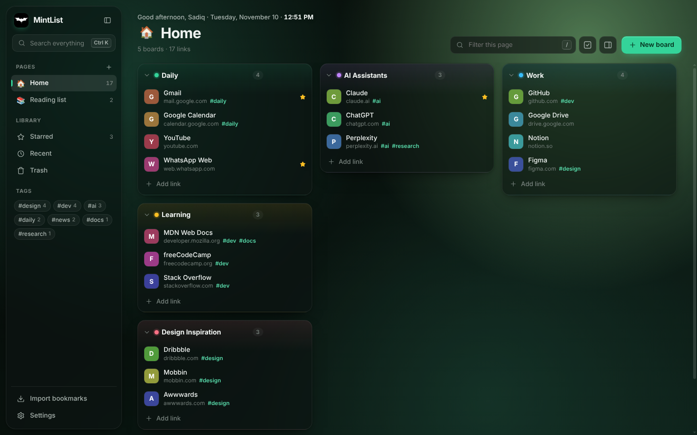
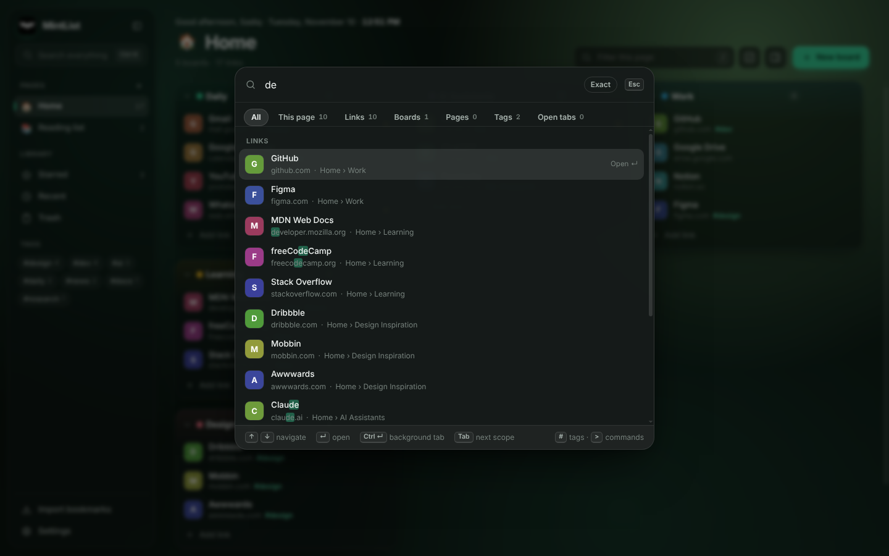
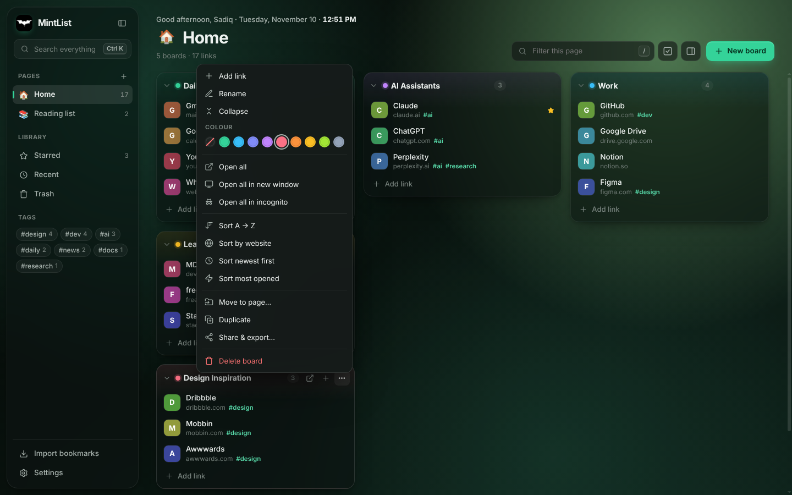
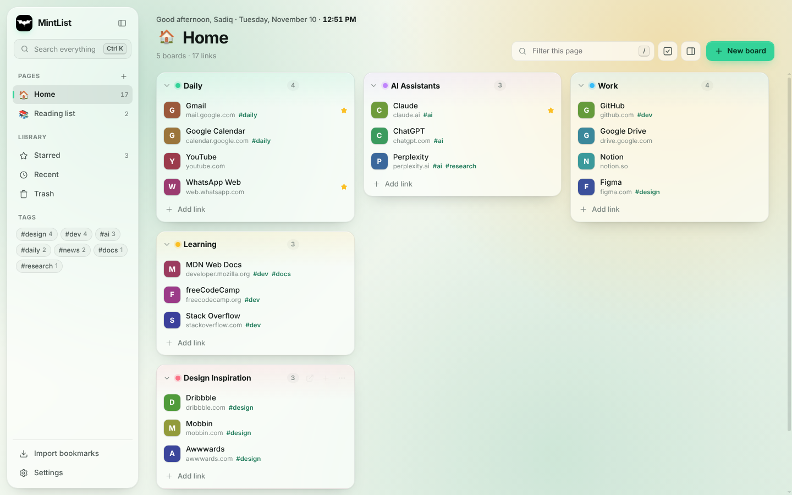
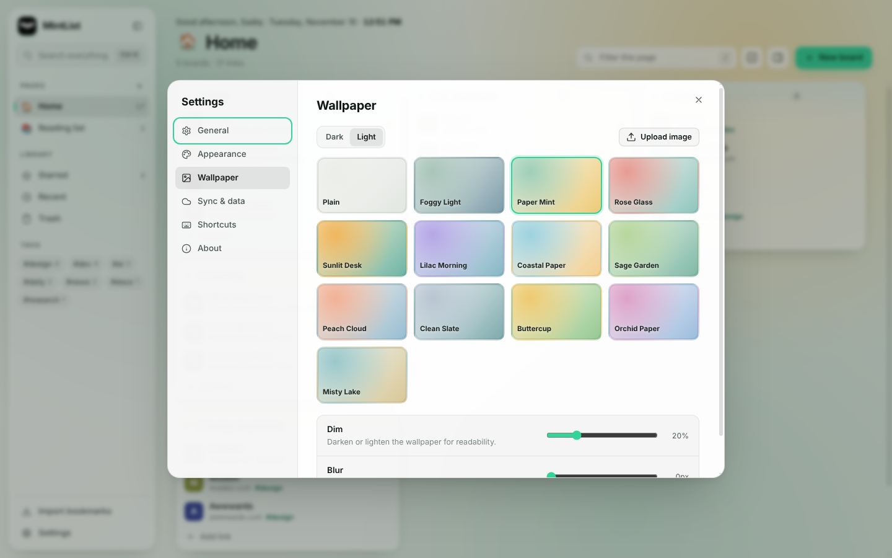
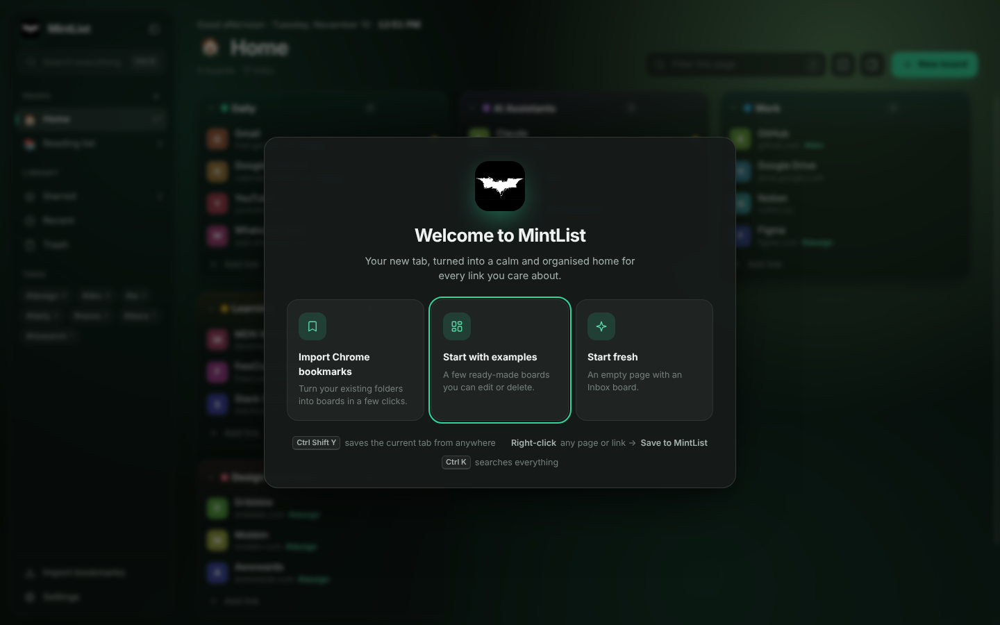
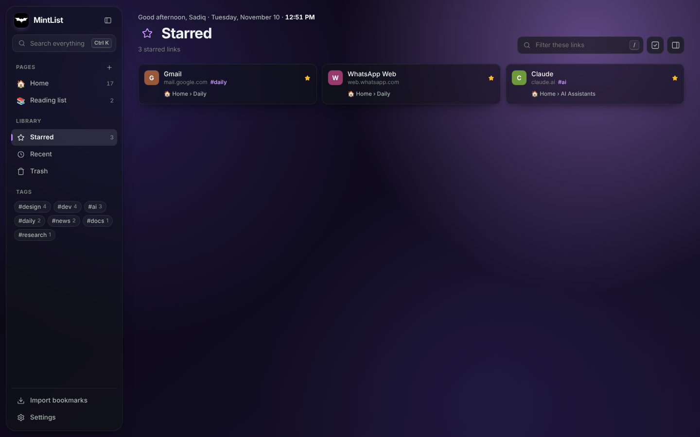
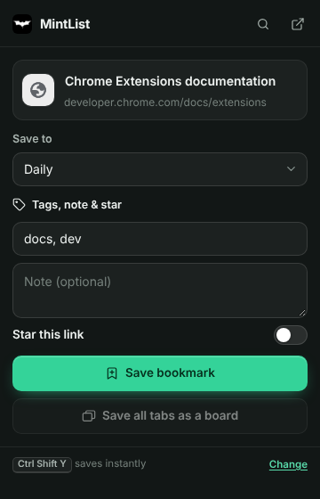

# MintList — Smart Bookmarks & New Tab

MintList turns Chrome's new tab into a calm, organised home for every link you care about. Group links into **boards**, group boards into **pages**, drag everything around, find anything in a keystroke, and save the page you're on without leaving it.

It's private by design: no account, no server, no analytics. Your library lives in your browser, with optional sync through your own Chrome profile.



## Features

### Organise
- **Pages → Boards → Links.** One page per project, role or topic, each with as many boards as you like. Pages get an emoji icon and can be reordered by dragging in the sidebar.
- **Drag and drop everything.** Reorder links within a board, move them between boards, drag boards between columns, drop a link or board onto another page in the sidebar, or onto *Trash* / *Starred*.
- **Drop links from anywhere.** Drag a link or the address-bar URL from any website straight onto a board.
- **Board colours, collapse/expand, sorting** (A→Z, by website, newest, most opened), duplicate, move to another page.
- **Tags and notes** on every link, plus **Starred**, **Recent** and per-tag views in the sidebar.
- **Bulk select** (press `S`): open, star, tag, move or delete many links at once.
- **Auto, 2–6 columns** and comfortable/compact density.

### Save
- **Toolbar popup** — save the current tab to any board, with title, tags, note and star. Shows if the page is already saved.
- **Quick save — `Ctrl+Shift+Y` (`⌘⇧Y` on Mac)** — saves the current tab instantly to your Inbox (or a board you pick in Settings). The toolbar badge confirms it.
- **Right-click → Save to MintList** on any page or link, with a submenu for every page and board.
- **Open tabs panel** (press `]`) — see every tab in the window, drag tabs onto boards, or **save all tabs** as a new board in one click.
- **Inline add** — paste a URL (or `Title | URL`, or a whole list) directly into a board.

### Find
- **Smart search (`Ctrl/⌘+K`)** across links, boards, pages, tags and open tabs, with **scope filters** (All · This page · Links · Boards · Pages · Tags · Open tabs), an **Exact match** toggle, `#tag` filters, fuzzy matching (`gml` → Gmail) and `>` commands.
- **Filter this page** (`/`) to narrow the visible boards as you type; `Enter` opens the first match.

### Import, export, share
- **Import Chrome bookmarks** — pick folders from a tree; each folder becomes a board (one page or one page per top-level folder). Duplicates can be skipped automatically.
- **Import files** — bookmark HTML from any browser, MintList backups (merge or replace), Toby-style and other JSON exports, Markdown or plain-text link lists.
- **Share a board or page** — copy a share code (paste it into another MintList), copy Markdown or a plain list, download a standalone web page or a browser bookmarks file, or send by email.
- **Export** a full backup (JSON, including wallpapers), browser bookmarks HTML, or Markdown.

### Safe
- **Trash with 30-day restore** for links, boards and pages, plus **Undo** (`Ctrl/⌘+Z`) after every delete.
- **Duplicate finder** that keeps the first copy and moves the rest to Trash.
- **Optional Chrome Sync** — keeps pages, boards, links and preferences in sync on every computer signed into the same Chrome profile (compressed, up to roughly 1,500 links).

### Make it yours
- **Themes:** match wallpaper, system, dark or light, six accent colours, glass or solid panels.
- **Wallpapers:** 25 built-in gradients or your own photo (automatically downscaled; light/dark detected), with dim and blur sliders.
- **Greeting & clock**, privacy blur for screen sharing, link-opening behaviour (new tab, background, same tab, incognito).

## Screenshots

| Smart search (Ctrl/⌘ K) | Board options |
| --- | --- |
|  |  |

| Light theme | Settings & wallpapers |
| --- | --- |
|  |  |

| Welcome & onboarding | Starred view | Save popup |
| --- | --- | --- |
|  |  |  |

## Keyboard shortcuts

| Shortcut | Action |
| --- | --- |
| `Ctrl/⌘ Shift Y` | Quick-save the current tab (works on any website) |
| `Alt Shift M` | Open the MintList popup |
| `Ctrl/⌘ K` | Search everything |
| `/` | Filter the current page |
| `1`–`9` | Switch to page 1–9 |
| `N` · `A` · `P` · `I` | New board · Add link · New page · Import |
| `S` | Select mode |
| `[` · `]` | Toggle sidebar · Toggle open-tabs panel |
| `Ctrl/⌘ Click` · `Shift Click` | Open in background tab · new window |
| `E` · `Del` | Edit · delete the focused link |
| `Ctrl/⌘ Z` | Undo the last delete |
| `?` | Show all shortcuts |

Browser-wide shortcuts can be changed at `chrome://extensions/shortcuts`.

## Install (developer mode)

```bash
git clone https://github.com/sadiqqgavvi-gif/MintList-Smart-bookmarks.git
```

1. Open `chrome://extensions` and turn on **Developer mode**.
2. Click **Load unpacked** and select the cloned folder.
3. Open a new tab — the welcome screen offers to import your Chrome bookmarks, start with examples, or start fresh.
4. Pin MintList from the puzzle-piece menu so the save button is always one click away.

To open links in incognito, also enable **Allow in Incognito** on MintList's details page.

## Project structure

```
MintList-Smart-bookmarks/
├── index.html            New-tab app (also the GitHub Pages demo)
├── popup.html            Toolbar "save" popup
├── options.html          Opens the app's Settings
├── manifest.json         Manifest V3 configuration
├── css/
│   ├── styles.css        Design tokens, themes and all components
│   └── popup.css         Popup layout
├── js/
│   ├── store.js          Data model, storage, migration, import/export & sync helpers (shared)
│   ├── background.js     Service worker: context menus, quick save, badge, Chrome Sync
│   ├── quick-theme.js    Pre-paints the cached theme so new tabs never flash
│   ├── icons.js          Stroke icon set
│   ├── ui.js             Element builder, menus, toasts, confirm, favicons, clipboard
│   ├── app.js            State, rendering, boards & links, drag and drop, trash, tabs panel
│   ├── palette.js        Smart search with scopes, exact match and commands
│   ├── dialogs.js        Link, page, move, share, settings, duplicates, welcome
│   ├── importer.js       Chrome bookmarks, HTML/JSON/text import, backups
│   ├── main.js           Startup, keyboard shortcuts, live updates
│   └── popup.js          Popup logic
└── icons/                Extension icons
```

No framework and no build step — plain HTML, CSS and JavaScript.

## How it works

- **One data model everywhere.** `store.js` is loaded by the new tab, the popup and the service worker, so they read and write the same `chrome.storage.local` record. Open new tabs update live when you save from the popup, the shortcut or the right-click menu.
- **Upgrades keep your data.** Libraries from MintList 1.x (freeform board positions) are migrated to the column layout automatically, roughly preserving where each board was.
- **Sync without a server.** When sync is on, the service worker compresses the library (gzip), splits it into chunks and stores it in `chrome.storage.sync`; other computers pick up changes automatically. Visit counts and wallpapers stay local.
- **Fast first paint.** `quick-theme.js` applies the cached theme before anything else loads.
- **Runs as a website too.** Every Chrome API is optional, so `index.html` also works as a plain web page (data is kept in `localStorage`).

## Permissions

| Permission | Why |
| --- | --- |
| `storage`, `unlimitedStorage` | Save your library and uploaded wallpapers locally |
| `tabs` | Read the current tab's title/URL for saving, list open tabs, open links |
| `contextMenus` | “Save to MintList” on right-click |
| `favicon` | Show site icons from Chrome's local favicon cache |
| `bookmarks` *(optional)* | Requested only when you choose to import Chrome bookmarks |

## License

This project is open source and available for review as part of my portfolio.
